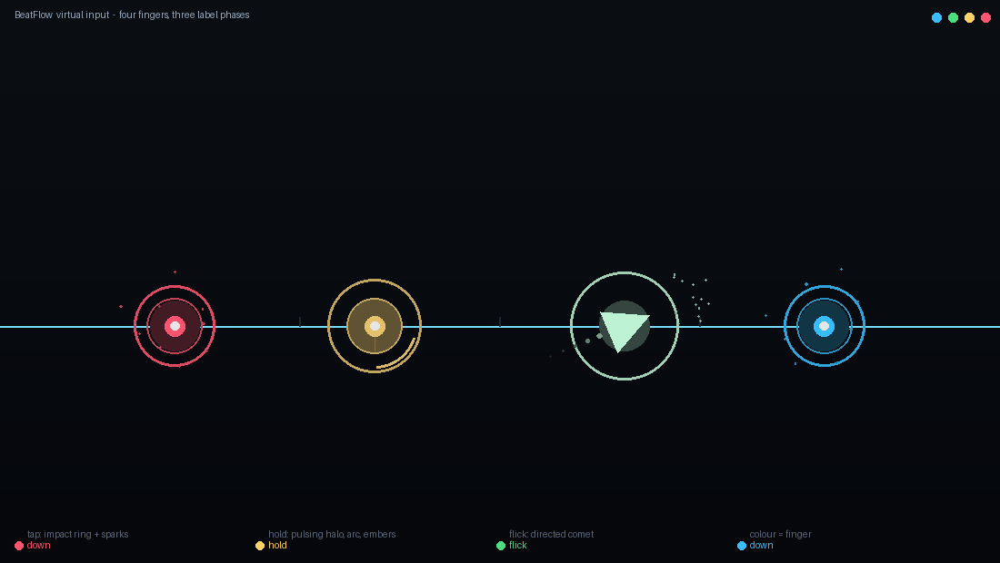

# beatflow_input — BeatFlow 虚拟输入模块

纯视觉 CNN+LSTM 打 Phigros 的**最后一厘米**：模型每帧输出「哪些手指按在哪里」，
这个包把它变成内核里真实的绝对多点触控事件（Linux `/dev/uinput`，MT protocol B）。

零第三方依赖：只用标准库（`ctypes` / `fcntl` / `struct`），本机没装 pip、numpy、
python-evdev 也能直接跑。

```bash
python3 -m beatflow_input probe                    # 检查 /dev/uinput
python3 -m beatflow_input plan  --chart "Glitch"   # 看编译出的动作时间线
python3 -m beatflow_input replay --chart "Glitch" --backend dryrun
python3 -m beatflow_input replay --chart "Glitch" --backend uinput
python3 -m beatflow_input watch  --chart "Glitch" --viz tk   # 4 指可视化（§10）
python3 -m unittest discover -s beatflow_input/tests -t .
```

> 包名就是目录名：`-m beatflow_input` 要求 checkout 目录叫 `beatflow_input`。
> clone 成别的名字时（比如 `BeatFlow`），在上级目录加一个软链再跑测试即可：
>
> ```bash
> ln -sfn "$(basename "$PWD")" ../beatflow_input && cd .. && \
>   python3 -m unittest discover -s beatflow_input/tests -t .
> ```

---

## 1. 一句话结论（相对交接文档的变化）

交接文档 §6 写的是「用户开发机是 Windows，uinput 是 Linux 接口，必须做
WinPointerBackend 兜底，只能在 WSL/真机验证」。**现在不成立了**：

| 项 | 实测（本机） |
|---|---|
| OS | CachyOS Linux，kernel 7.3 |
| 会话 | **Wayland 原生**（`XDG_SESSION_TYPE=wayland`） |
| `/dev/uinput` | 存在，ACL 已授予 `wangzhilin` `rw-`，**可直接写** |
| 虚拟设备 | 成功创建 `BeatFlow Virtual Touch` → `/dev/input/event20`，10 个 MT 槽位 |
| Python | 3.14.8，**无 torch / numpy / cv2 / pip** |

也就是说：**这台机器就是交付目标本身**，注入层可以本地开发 + 本地实测，
不需要 Windows 兜底后端，也不需要 WSL。§8.1 的三后端方案收缩为两层：

```
TouchBackend
├── UinputBackend   # 真实设备（本机可用）
└── DryRunBackend   # 录制/回放/回归测试/无副作用计时
```

---

## 2. 数据流

```
map-set-labels/*.jsonl          （或模型逐帧输出）
        │  labels.py            —— 稀疏事件流 → Chart
        ▼
     actions.py                 —— 状态机：合成 up、flick、hold 延续
        │                        —— 逐帧 diff → press / move / release
        ▼
     slots.py                   —— 逻辑 note id → 物理 MT 槽位（容量、复用、抢占）
     geometry.py                —— [-1,1] → 屏幕像素 → 设备绝对坐标（含 letterbox）
        ▼
     injector.py                —— 每帧一批 op + 一次 commit
        ▼
     scheduler.py               —— 绝对 deadline + 混合 sleep/spin，逐帧计时
        ▼
     backends/uinput.py         —— ABS_MT_SLOT / TRACKING_ID / POSITION_X/Y + SYN_REPORT
```

关键设计：**注入的是「每帧应该有哪些手指按着」的状态，不是「事件」。**
`actions.py` 为每一帧推导出接触集合，相邻两帧做 diff 才产出 press/move/release。
这样丢帧不会产生幽灵手指，id 消失必然对应一次 release，不会漏抬手。

---

## 3. 和模型侧的接口契约

`model_api.py`，是给另外两位同学对接用的部分：

```python
# 每帧（60 Hz）输出一个列表，空列表 = 该帧没有任何手指
[PredictedContact(id=0, x=-0.40, y=0.375),
 PredictedContact(id=1, x= 0.42, y=0.375)]
```

| 约定 | 说明 |
|---|---|
| `x, y` | 游戏归一化坐标 `[-1, 1]`，与标签同一套；越界直接抛错（拒绝静默 clamp，方便抓模型跑飞） |
| `id` | 按住期间必须稳定；同帧内不得重复。建议用单调自增整数 |
| 生命周期 | 只出现 1 帧 → 自动变成 tap；连续 N 帧 → 变成 hold；按住期间位置变化 → 自动产生 move，游戏按 swipe 判定 flick |
| 空帧 | 允许且常见，成本为零（不产生 uinput 写入） |

```python
from beatflow_input import FramePrediction, PredictedContact, timeline_from_predictions
tl = timeline_from_predictions([FramePrediction(0, (PredictedContact(0, -0.4, 0.375),))])
```

数据集回放走的是**同一条** `build_timeline` 路径，所以回放里修好的 bug 在线
agent 上自动也是修好的。

---

## 4. 标签语义与「我们猜的部分」

标签是**稀疏的意图描述**，不是手指录制。已确认的事实：`phase` 只有
`down/hold/flick`，**没有 `up`**；没有事件的帧完全缺席；帧号会跳；
`bad` 标记越界坐标（约 0.68%）。

因此下面这些都是**合成规则**，全部可配，且都标出了依据强弱：

| 规则 | 默认值 | 依据 | 风险 |
|---|---|---|---|
| tap 按住时长 | 2 帧（≈33 ms） | 游戏逐帧读状态，1 帧理论够，多给 1 帧容忍对齐误差 | 低 |
| flick 形态 | press → 下一帧 move → 2 帧后 release | 游戏靠位移判 swipe | **方向不在数据里**，默认 `(0, +0.20)`，需视频验证 |
| hold 结束 | id 停止出现后再留 2 帧 | 真实抬手帧未知 | 低 |
| hold 期间位置 | `pinned`：冻结在按下点 | 记录的 y 单调爬升（0.059→0.375）是**音符**在动，不是手指 | 中，见 §7 |

`hold_tracking` 三档：`pinned`（默认，物理正确）/ `follow`（跟随记录坐标，
模型输出用这档）/ `judgment_line`（把 y 钉在 0.375 判定线）。

---

## 5. 坐标

三层空间必须分清，混用就是「整体偏 200 像素」的经典 bug：

1. **游戏空间**：标签里的 `x, y ∈ [-1,1]`，原点在屏幕中心，`+y` 向上。
2. **屏幕空间**：输出分辨率下的像素。
3. **设备空间**：`ABS_MT_POSITION_X/Y` 的 `0..32767`，`+y` **向下**，覆盖整个输出。

```python
Geometry.fullscreen(1920, 1080)                    # 全屏无边框
Geometry.letterboxed(1920, 1080, 1024, 768)        # 4:3 游戏放进 16:9 输出
Geometry.windowed(1920, 1080, 810, 390, 300, 300)  # 明确窗口矩形
```

Wayland 下取不到窗口几何（客户端不知道自己在哪），所以**窗口模式必须手工给**。
全屏游戏用 `fullscreen` 即可。另外注入点是绝对坐标，**游戏窗口必须有焦点**，
否则 touch 会落到坐标下方的那个 surface 上。

---

## 6. 容量与溢出

标签里 `slot` 最大到 **94**，但那是「跨帧持久化键」，不是手指编号。
本模块用 `SlotAllocator` 把它映射到物理槽位：

- 默认 10 槽（`--capacity`），空闲槽优先复用；
- 满了以后策略二选一：`drop`（丢掉新音符）或 `steal_lru`（抢占最老的并复用其槽位，默认）；
- 抢占时会先发 `TRACKING_ID=-1` 再发新 id，保证内核看到的是「抬手 + 按下」而不是瞬移。

**全量 1047 个谱面实测**（把标签编译成时间线，统计同帧最大同时接触数）：

| 同帧峰值 | 谱面数 | 占比 |
|---|---|---|
| ≤4 | 625 | 59.7 % |
| 5–8 | 353 | 33.7 % |
| 9–12 | 41 | 3.9 % |
| 13–20 | 18 | 1.7 % |
| >20 | 10 | 1.0 % |

| 容量 | 会溢出的谱面 |
|---|---|
| 4 | 422（40.3 %） |
| 6 | 191（18.2 %） |
| 8 | 87（8.3 %） |
| **10（默认）** | **47（4.5 %）** |
| 16 | 17（1.6 %） |

极值是 `Vs. Frisk [Battle In Chaos]` 的 **94 指同帧**——正好等于它 manifest 里的
`max_slots=94`，属于整活谱面。结论：

- PPT 写的「4 指同时」只覆盖 60 % 的谱面，**10 槽是性价比拐点**（覆盖 95.5 %）；
- 内核允许到 64 槽，真需要可以 `--capacity 16` 覆盖到 98.4 %；
- 但游戏自己未必认 94 个触点，极端谱面本就不在评估范围内——按需上调即可。

---

## 7. 还没定论的事（别当已知事实写进代码）

**hold 期间同一 id 的 `y` 单调爬升、`x` 不变**（例：id=17179869184，
frame 624→678，y: 0.059→0.375）。两种解释：
音符位置在动 / 手指真的在滑。**必须用真视频叠加验证**才能定注入点该用
`(x, y)` 还是 `(x, 0.375)` —— 需要先下 3.56 GB 训练集。

在验证之前：回放用 `pinned`，模型输出用 `follow`，代码里没有把它写死。

**flick 方向同样未知**。数据里 flick 只有一帧、一个点。默认向上滑，需视频确认。

---

## 8. 实测数字（本机，2026-11-01）

设备创建/销毁、3 指点按与移动、4 指同时按下全部跑通。

真实 `uinput` 后端回放（1920×1080，窗口 300×300 映射到屏幕中央）:

| 指标 | p50 | p95 | p99 | max |
|---|---|---|---|---|
| 调度偏差（目标 → 开始注入） | 2.2 µs | 4.3 µs | 4.9 µs | 15.2 µs |
| 注入耗时（op → commit 返回） | 138 µs | 227 µs | 243 µs | 341 µs |

每帧预算 16 667 µs，注入占 **< 2%**。`DryRun` 全谱面回放：1345 帧 / 3101 op
仅需 8 ms（记录开销），说明瓶颈只在 `write()` 系统调用，不在 Python。

> 注意：这是在桌面空闲时测的。真正的端到端延迟还包括「录屏 → 推理 → 决策」，
> 注入侧已经把预算让出来 98%。

---

## 9. 代码地图

| 文件 | 作用 |
|---|---|
| `backends/base.py` | `TouchBackend` 抽象：press/move/release/commit |
| `backends/uinput.py` | 真实设备，纯 ctypes；含 `UI_DEV_SETUP` / `UI_ABS_SETUP` |
| `backends/dryrun.py` | 录制后端，可 dump 成 JSONL |
| `geometry.py` | 三层坐标 + letterbox |
| `slots.py` | 逻辑 id → 物理槽位，drop / steal_lru |
| `labels.py` | 读 zip 或目录，`manifest.json` 驱动，无需解包 |
| `actions.py` | 标签 → 逐帧接触集合 → press/move/release |
| `injector.py` | op → 槽位 + 坐标 → 设备 |
| `scheduler.py` | 绝对 deadline 播放 + 延迟统计 |
| `model_api.py` | 模型输出契约 + 适配器 |
| `cli.py` | `probe / list / plan / replay / watch / selftest` |
| `visualizer/` | **插件**：4 指实时可视化。`protocol.py` 管道协议、`scene.py` 特效引擎、`terminal.py` / `tkview.py` 两个渲染器、`live.py` 生产端 |
| `docs/` | 效果示意图 + 生成脚本（`docs/` 里的脚本需要 Pillow，包本身仍然零依赖） |
| `tests/` | 58 个用例，含真实 `/dev/uinput`（无设备时自动 skip） |

---

## 10. 可视化插件（4 指实时预览）

`visualizer/` 回答一个问题：**注入层此刻认为哪几根手指按在哪里？**
颜色 = 手指（物理槽位），形状与运动 = 标签相位。

| 相位 | 视觉 | 想表达 |
|---|---|---|
| `down` | 白色高亮核心 + 快速衰减的实心闪光 + 双层扩散圆环 + 径向火花 | 一次**撞击**，约 0.25 s 内消失 |
| `hold` | 呼吸光晕（半径随时间脉动）+ 旋转圆弧 + 向下定位杆 + 持续上飘的余烬 | 一个**持续状态**，永远不"结束" |
| `flick` | 沿滑动方向的彗尾（6 段渐隐）+ 三角箭头 + 锥形火花 | 一次**位移**，不是撞击 |



> 图是离线栅格化的文档示意（`docs/make_effects_preview.py`），绘制数学与
> `tkview.py` 一致，便于放进 PPT。

```bash
# 不需要谱面、不需要设备，先看效果（最快的一条路）
python3 -m beatflow_input.visualizer.terminal --demo
python3 -m beatflow_input.visualizer.tkview --demo

# 接真实谱面：默认 dryrun，不碰内核
python3 -m beatflow_input watch --chart "Glitch" --viz tk
python3 -m beatflow_input watch --chart "Glitch" --viz terminal   # SSH / 无 GUI 也成立

# 真机演示：窗口 + 真实 uinput 注入同时进行
python3 -m beatflow_input watch --chart "Glitch" --viz tk --backend uinput
```

`watch` 是 `replay` 的实时版本：它按墙钟播放，**不**因为可视化而改变注入时序
（`--speed` 默认 1.0；想快进看特效可以调大，但那样看到的是压缩后的节奏）。

### 为什么渲染器是独立进程

父进程把状态写成 NDJSON 喂给子进程（`visualizer/protocol.py`）。两个理由：

1. 注入循环按绝对 deadline 自旋，**不能让一次 60 fps 重绘挤进 16.7 ms 预算**；
2. Tk 必须独占主线程，而 `TimelineRunner` 已经在用主线程。

父进程每帧只付 `json.dumps` + 一次管道写。实测（SUPERNOVA，1577 commits，全程
挂着 terminal 渲染器）：调度偏差 p50 **1.3 µs** / p99 79 µs，注入耗时 p50
**53.7 µs** —— 渲染开销没有出现在注入数据里。子进程崩了（没有显示器、窗口被关）
也只会静默停止，注入继续。

### 帧是「状态」而不是「事件」

每帧发的是「现在有哪些手指按着」，渲染器自己 diff 出按下/抬起/切换。
这与 §2 的注入设计同一条原则：**丢一帧不会留下幽灵手指**。

### 加一个新渲染器

1. 写一个模块，`main()` 从 stdin 逐行读 NDJSON（`protocol.parse`），用
   `scene.Scene` 驱动绘制；`Scene` 与渲染器无关，同样的 `down` 在终端和窗口里
   语义一致，只有画笔不同；
2. 在 `visualizer/live.py` 的 `RENDERERS` 里加一行。

### 已知限制

- **Wayland 下不能做「盖在游戏上的透明层」**：那需要 layer-shell 客户端，
  不是标准库能做到的事。所以它是一个独立窗口/终端；全屏游戏时窗口会被
  compositor 挡在后面，适合放在副屏，或者用 `--viz terminal` 在另一个终端看。
- 特效的相位来自谱面标签（`phase_map`）。接模型输出时没有标签，渲染器会按
  「存活时长 / 速度」推断（`auto`）：>0.12 s 判 hold，速度 >0.55 判 flick。
  这时特效是**装饰性**的，不要拿它当相位正确性的证据。

---

## 11. 下一步

1. **用真机 + 真游戏验证**（最高优先级）：在本机跑 Phira，`--backend uinput`
   点一遍，确认窗口能收到 touch、坐标不偏。这一步不需要模型。
2. **视频叠加验证坐标语义**（§7）：拿到训练集后抽 1 帧，把标签点画上去。
3. **端到端延迟测量**：加打点，量「帧捕获 → 推理 → 注入」总时长。
4. 数据管线（重写 `Test.py`）—— 本机仍需先装 numpy/torch（Python 3.14 不支持
   PyTorch，得装 3.12 或 3.11 的解释器）。
